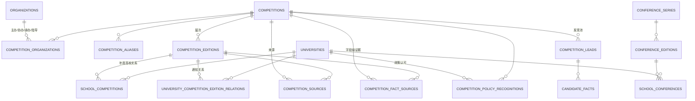

# 学生竞赛平台 · 底层数据架构重构设计（V0.9）

目标：把平台从“高校通知驱动的竞赛信息汇总系统”升级为“以竞赛/学术会议实体为核心，以届次、高校关系、权威来源为证据链的高校学术与创新机会数据库”。

本设计以真实代码为准（审计见 [data-architecture-audit.md](data-architecture-audit.md)），不机械照搬建议字段；已有表尽量保留，缺失层增量补齐。

---

## 1. 目标分层

```text
竞赛/会议实体（永久）                   组织层 organizations
   │                                        │
   ├─ competition_editions（届次）          ├─ university/college（已有）
   │   └─ school_competitions（高校关系目录） ├─ ministry/committee/society/enterprise
   │       └─ 高校通知/政策证据                └─ 组委会/承办单位
   └─ conference_series ─ conference_editions ─ school_conferences

证据链（两段）：
  发现层：competition_leads / candidate_* / policy_raw_items（低权威，允许噪声）
  事实层：competition_fact_sources / competition_sources / policy_documents（按权威等级晋升）
```

## 2. ER 总览（目标态）



## 3. 各层模型规格（真实代码对齐）

### 3.1 competitions —— 赛事主体（保留现有，小修补）

保留现有所有列（API/前端强依赖）。本轮修补原则：

- `entity_type` 只允许 `competition/series/track`；award/festival/exhibition 等不再直接出现在正式赛事查询里（隔离而非删除）；
- `category` 逐步改为受控学科键（由 disciplines 映射，下阶段）；
- `edition_count` 未来改为只读派生值；现有写入保留兼容；
- `history_timeline/development_history/founded_year` 保留为“永久层摘要”，有据可查的历史届次迁移进 competition_editions。

### 3.2 competition_editions —— 届次（保留现有，补 3 个可空列）

新增可空列（本轮落地）：

- `host_location`（举办地/城市）
- `edition_rules_url`（该届章程/规则原文 URL）
- `edition_status`（该届公告状态：announced/registration_open/submission_open/finished/archived；与 `current_status` 并存，前者带来源语义）

约束：`registration_deadline` 不再接受新写入（保留读兼容）；新时间只写 official/university/college 语义字段。禁止“校内晚于官方”写入，写入前做校验（服务层 + migration 修复脚本）。

### 3.3 school_competitions —— 高校×赛事目录（下阶段落地，先给规格）

说明：审计发现真实缺口是“高校页面读空表、真实认可与通知没有聚合”。本轮**不建物理表**，因为其写入应建立在 P1/P5（关系核验语义与字段补齐）完成后，否则又是一张会被学校通知污染的派生表。下阶段模型规格：

```text
school_competition_records
  id, school_id(FK universities), competition_id(FK competitions),
  competition_edition_id(FK, 可空), year,
  recognition_status, school_level, school_category,
  responsible_department, campus_notice_url,
  campus_registration_deadline, campus_selection_date,
  credit_policy, award_policy, participation_status,
  evidence_ids(JSON: policy_document_ids/relation_ids),   -- 证据链
  verified_at, created_at, updated_at
  UNIQUE(school_id, competition_id, competition_edition_id, year)
```

填充来源与优先级：

1. `competition_policy_recognitions`（政策目录认可，识别 A/B/Ⅰ/Ⅱ 类与 usage_type）
2. `university_competition_edition_relations`（校内通知、截止、负责部门）
3. 人工复核 `review_queue` 结果

切换顺序：表建成 → 回填 → 单元验证 → 后端新端点 `/api/universities/{id}/competition-catalog` → 前端高校页切换（最后一步不在本轮）。

### 3.4 sources —— 证据层（保留现有两级结构，补 authority 语义）

现有 `competition_sources`（来源主表）与 `competition_fact_sources`（字段级）是合理的两级证据模型。本轮改动：

- `competition_leads.review_status` 状态机（落地）；
- 修正晋升规则：高校通知只能把**校内事实**（关系行、校内截止、组织部门）标为官方已核实；全国赛事事实只有在存在 S/A 级来源（government_official_notice / organizer_official / official_notice / competition_official_site）时才允许置 `verified_official`；
- 建议（下阶段）：给 `competition_sources` 增加 `authority_level`（S/A/B/C）与 `organization_id`，并用受控 source_type 词表替换自由字符串。

权威等级映射（后端统一常量）：

```text
S: ministry / government / official_committee / competition_official_site
A: academic_association / national_society / organizer_official_notice
B: university / college / provincial_government
C: third_party / github_seed / social_media
```

### 3.5 organizations —— 统一机构层（本轮落地）

物理表 `organizations` + 关系表 `competition_organizations`：

```text
organizations
  id, name(unique), aliases(JSON), org_type,
  country_or_region, official_website, official_domain,
  description, status, is_demo, created_at, updated_at

competition_organizations
  id, competition_id(FK), organization_id(FK), role,
  display_name(保留原始字符串便于核对),
  verified(bool), source_url, created_at
  UNIQUE(competition_id, organization_id, role)
```

role 词表：`organizer / co_organizer / guiding / undertaker / host`。

高校/学院仍以 universities/colleges 为准（已有），organizations 面向教育部、学会、组委会、企业等非高校主体；两类在 API 层以“organization 统一视图”暴露（下阶段）。

回填规则（本轮脚本）：

- 从 `competitions.organizer/co_organizers/guiding_organizations/undertakers` 解析出名称（按 、/,/； 分隔并 trim）；
- 同名字符串归一（去除空格、统一括号）后 upsert organizations；
- 写入 competition_organizations（role 对应），display_name 保留原文；
- `is_verified=False` 直到人工或权威来源确认（回填不冒充官方）。

### 3.6 disciplines —— 学科体系（设计建议，下阶段）

用现有 `tags(category)` + `majors` 作为基础，新增 `disciplines` 受控表 + `competition_disciplines`/`conference_disciplines` 关系；`competitions.category` 保持兼容字符串但写入前映射到 discipline key。本轮不改 category 数据（避免搜索/筛选回归）。

### 3.7 competition_discovery_candidates —— 发现池（本轮先状态化 leads）

已有 `competition_leads` 承担发现池职责；新增列 `review_status`：

```text
review_status: pending | matched | verified | rejected | duplicate
```

回填映射（脚本）：

- `matched_competition_id` 存在且 `needs_review=False` → `verified`
- `matched_competition_id` 存在且 `needs_review=True` → `matched`
- 无匹配且 `needs_review=True` → `pending`
- `needs_review=False` 且无匹配（极少）→ `pending`
- 后续人工/批处理可置 `rejected / duplicate`

下阶段再把“政策目录逐行候选”`candidate_competitions` 统一进同一状态机（加 review_status + source_school 可空列）。

### 3.8 会议基础模型（本轮落地，无 UI 无假数据）

按用户建议但做真实代码调整：把 `conference_series` 作为永久层、`conference_editions` 作为届层、`school_conferences` 作为高校关系层；字段避免复制竞赛专属字段（不存保研等级、不存校内选拔制），只保留会议自身的结构化信息。

```text
conference_series
  id, name(unique), short_name, aliases(JSON), discipline(受控键, 可空),
  organizer_summary(Text), official_website, first_held_year,
  conference_scope, description, status,
  created_at, updated_at

conference_editions
  id, conference_series_id(FK), year,
  edition_name, start_date, end_date,
  location, country_or_region, city, online_status,
  abstract_deadline, paper_deadline, notification_date,
  camera_ready_deadline, registration_deadline,
  call_for_papers_url, edition_official_url,
  publication_info, indexing_info, submission_language,
  participation_type, edition_status,
  source_url, is_verified, verification_status, last_verified_at,
  created_at, updated_at
  UNIQUE(conference_series_id, year)

school_conferences
  id, school_id(FK universities), conference_series_id(FK),
  conference_edition_id(FK, 可空), relation_type,
  responsible_department, notice_url, campus_deadline,
  notes, is_verified, verification_status, created_at, updated_at
  UNIQUE(school_id, conference_edition_id, notice_url)
```

relation_type 词表：`hosting / co_hosting / participation_notice / call_for_papers_notice / organized_by_college / other`。

会议“发现→核验”顺序（未来管线）：中国科协 → 全国性学会/协会 → 专业委员会 → IEEE/ACM 等国际组织 → 会议官网 → 高校/院所 → 第三方。普通讲座、单场报告、内部沙龙不进入正式会议库，只允许进入发现池（未来可复用统一 lead 表，加 entity_kind=conference）。

### 3.9 会议未来还需扩展的字段（问题 F）

设计已预留的：投稿系统 URL、录用率/接受率、投稿语言、索引信息、出版信息、线上/线下状态。

还需补（正式接入会议数据时）：

- 征稿/截稿的时间线细分（workshop/panel/submission 多 deadline，需 deadline 子表或结构化 JSON，不建议复制竞赛的 deadline 列矩阵）；
- 是否收费/注册费、投稿主题（track/call area 子表）；
- 会议周期（annual/biennial）与届次命名规则；
- 主办/承办/协办组织的 organizations 关系（与竞赛共用）；
- 高校内部组织信息（是否由本校学院承办、参会资助、会议等级认定——只在 school_conferences，不进会议主体）；
- 多来源证据与来源快照复用统一 sources 设计；
- 会议历史（前几届时间地点）由 conference_editions 自然承载，无需文本字段。

---

## 4. 增量变更清单（D1–D6）

| 编号 | 内容 | 状态 | 影响面 |
|---|---|---|---|
| D1 | `competition_editions` 增加 host_location / edition_rules_url / edition_status（可空） | 本轮落地 | 仅加列；API schema 同步补可空字段 |
| D2 | `competition_leads` 增加 review_status（可空 + 索引） | 本轮落地 | 仅加列；发现池状态化 |
| D3 | 新增 `organizations` + `competition_organizations` | 本轮落地 | 增量表；无 API/前端依赖 |
| D4 | 新增 `conference_series` / `conference_editions` / `school_conferences` | 本轮落地 | 增量表；无 UI 不造数据 |
| D5 | 回填脚本：organizations、review_status、目录发现实体降级清单 | 本轮落地 | 幂等 upsert；不改旧行值（降级清单仅输出报告） |
| D6 | school_competitions 物理表与高校目录 API | 设计建议 | 下阶段（依赖 P1/P5 修复后） |
| D7 | disciplines 受控学科表 | 设计建议 | 下阶段 |
| D8 | sources authority_level 与统一组织外键 | 设计建议 | 下阶段 |
| D9 | 学校级来源晋升规则收紧（P1 修复） | 设计建议 | 需要改导入服务 + 历史数据重算，单独成阶段 |

## 5. 迁移脚本设计

新增 Alembic 迁移 `202609040001_v09_architecture_foundation`（upgrade 全幂等、downgrade 只 drop 新表/新列），随后运行 `backend/scripts/run_architecture_backfill.py`：

1. 自动备份 SQLite（`data/backups/backup-<ts>.sqlite`）；
2. upsert organizations / competition_organizations（按归一化名称 + role）；
3. 为 leads 回填 review_status；
4. 修复 e22 类“校内晚于官方”异常（写入 report，不静默覆盖；仅当证据充分时按官方时间为准修正，否则保留并标记）——本轮只输出清单，不自动改值；
5. 生成 `data/reports/v09_architecture_backfill_report.json`，包含新增行数、组织分布、状态分布、异常清单、未匹配线索分类数。

本轮实际执行结果（2026-09-04，开发库 `data/v02.sqlite`）：

- 迁移前备份：`data/backups/v02-before-v09-architecture-20260904.sqlite`
- Alembic head 已到 `202609040001`；新增 5 张表与 4 个列
- 回填结果：67 个 organizations、84 条 competition_organizations 关系；491 条 leads 状态为 verified 141 / matched 14 / pending 336
- 幂等校验：回填脚本可重复执行；报告写入 `data/reports/v09_architecture_backfill_report.json`

环境注意：当前 Windows/SQLite 环境下，`alembic upgrade` 能执行 DDL，但 `alembic_version` 可能不自动更新（副本上验证、含 `stamp` 命令）；执行后请核对 `alembic current`，如未更新则直接 `UPDATE alembic_version SET version_num='<head>'` 收尾。PostgreSQL 部署不受该问题影响。

## 10. 第二轮执行记录（2026-09-04，竞赛核心语义重构）

迁移 `202609040002_v09_school_competitions` 已执行并手工收尾版本号（head=`202609040002`）。新增/扩展：

- `school_competitions`（school_id + competition_id 唯一，竞争主体可空 edition）
- `competition_sources.authority_level`（S/A/B/C/D）
- `competition_leads.duplicate_of_id`

语义重算脚本 `backend/scripts/run_v09_semantic_refactor.py` 已执行（幂等，可重复）：

- 236 个来源全部回填 authority_level（S=11、B=178、C=23、D=24）
- 10 个赛事保留 `verified_official`；32 个 `school_confirmed`；89 个 `pending_verification`；12 个 `unverified`
- 5 个届次保留 `verified_official`；40 个 `school_confirmed`；8 个 `pending_verification`
- `school_competitions` 落库 172 行（102 目录行 → 102 行；75 通知行 → 70 行，5 条同校同赛合并，75 条全部在 provenance 中保留）
- 63 个“仅高校目录来源”赛事降为 `pending_verification`（实体、别名、来源与关系全部保留）
- 491 条 lead：35 verified / 109 matched / 314 pending / 33 duplicate
- 5 条旧 `registration_deadline`（校内镜像）清空，官方/校内字段原值保留

剩余需人工确认项（审计 `data/reports/v09_quality_audit_report.json`，10 pass / 2 warn / 1 fail）：

- e22「中国首届“新域新质”创新大赛」校内截止（09-30）晚于全国截止（09-15），证据不足不自动改值
- 7 个届次有全国截止值但尚无 S/A 级来源（值保留，届次状态已降级，等待权威来源确认）
- 21 个 track 型 Competition 行与 competition_tracks 双轨并存（架构性告警，另行处理）

去重方案（写成服务层算法，非一次性 SQL）：

- 实体归一：保留 `competition_aliases` + normalization service；新增别名时先查 normalized_alias；
- lead 去重键：`(source_url, raw_title)` 外增加 `content_hash` 归并（同文不同 URL → 主 URL + 镜像 URL）；
- 学校目录行去重：同一学校目录同一 raw_name 与行号唯一（candidate_competitions 已有唯一键）；
- 主库查重：定时跑 normalized-name/alias 撞名报告（现有 `_duplicate_groups` 已有雏形，升级为含 aliases 的组判重）。

## 6. API 兼容方案

- 不删除、不改名任何现有字段；Pydantic schema 只在 `CompetitionEditionRead` 增加 3 个可空字段（新数据可为 null，前端无需改动即可通过类型检查）；
- 现有端点语义不变（`/competitions`、详情、高校、统计、发现池 coverage 等）；
- 新增端点一律挂 `/v0.9/` 前缀（组织列表、lead review 状态查询），不与旧路由冲突；
- school_competitions 高校目录端点 `/api/universities/{id}/competition-catalog` 放在 D6 阶段再上线。

## 7. 前端受影响与切换顺序

本轮前端零改动。受影响的后续顺序：

1. 数据口径修复（P6 截止、P7 官方标记）无需前端代码改动，仅后端与数据；
2. 高校目录页数据源从 `/competition-policies`（空）切换到新的 `/competition-catalog`（D6），改动仅 universities/[id]/page.tsx；
3. 新增组织/会议模块的前端入口在真实数据形成后再做；
4. 本轮不添加任何写死的“热门会议/AI 推荐/截止时间”等占位 UI。

## 8. 测试计划

- 迁移测试：在空库/旧 schema 上执行 upgrade，验证 3 个新表与 3+1 新列存在，downgrade 可回滚；
- 幂等测试：连续两次执行回填脚本，行数不重复；
- 单元测试：organizations 解析（分隔符、去空格、同义括号）、review_status 映射、会议模型关系；
- 回归测试：现有 pytest 全绿，证明模型新增未破坏 API；
- 兼容冒烟：启动后端，请求 `/api/competitions`、详情、`/api/universities/1`、stats，返回结构与变更前一致。

## 9. 本轮实际修改 vs 设计建议（问题 G 明细）

已实际修改（本轮）：audit 脚本、本文档、Alembic 迁移 D1–D4、回填脚本 D5、模型文件注册、基础测试。

仅设计建议（未改代码）：D6 school_competitions 物理表、D7 disciplines、D8 sources authority 改造、D9 晋升规则收紧、会议数据管线与 UI、学校页面切换。
